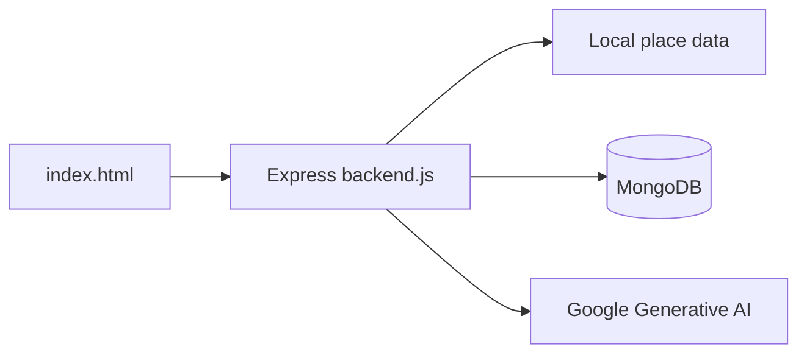

# Mysore Travel Chatbot

## Project overview

Mysore Travel Chatbot is a small Express service and browser client for answering travel questions about Mysuru. The repository combines a local place dataset with a conversational backend so a visitor can ask for destination information without navigating a static list manually.

## Problem statement

Travel information is often distributed across pages and notes. This project provides a single conversational entry point backed by the repository's curated place data.

## Implemented features

- Browser interface served from `index.html`.
- Express backend started by `backend.js`.
- Place data and seed helpers in `data.js`, `Places.txt`, and `seed.js`.
- MongoDB and Google Generative AI integrations are configured in the backend.

## Architecture



## Technology stack

| Layer | Technology | Role |
|---|---|---|
| Web server | Node.js, Express | Serves the UI and chatbot endpoints |
| Data | MongoDB | Stores application data when configured |
| AI | Google Generative AI client | Generates conversational responses |
| Frontend | HTML and JavaScript | Provides the browser interaction |

## Setup and running

```bash
npm install
npm start
```

The `start` script runs `node backend.js`. Configure database and AI credentials through environment variables; do not commit them.

## Project structure

- `backend.js` — Express application and integrations.
- `index.html` — browser client.
- `data.js`, `Places.txt` — place information.
- `seed.js` — data seeding helper.

## Current limitations

The repository is a prototype and does not include a separate automated test suite or a documented production deployment workflow.

## License

No license is currently declared.
